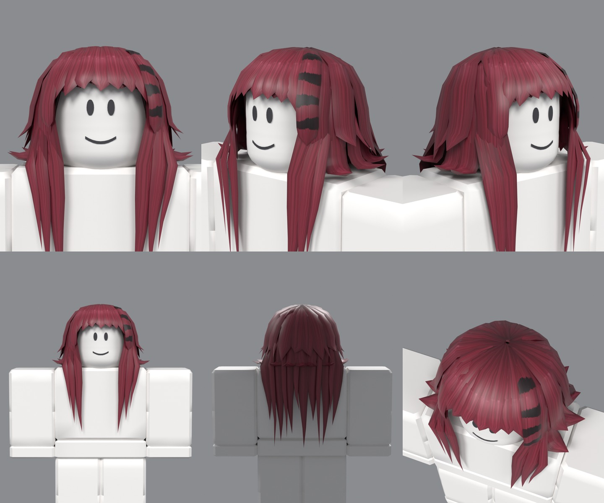

# Cherry wolf-cut + hime-cut hair — Roblox UGC (rigid accessory, Hair, R15 Classic)

Anime / Y2K / emo hair built in Blender 4.x around Roblox's official R15 blocky character:
thick choppy bangs to the eyebrows, hime side locks, a round crown with a short choppy layer,
flipped tips at shoulder level, thin sharp layers to the waist (chest + back), and one
tiger-striped strand on the character's left.



## Files

| File | What it is |
| --- | --- |
| `export/CherryWolfHime_Hair.fbx` | The accessory mesh, colour texture embedded. Import this into Studio. |
| `export/CherryWolfHime_Hair.obj`, `.mtl` | The same mesh as OBJ, for tools that don't read FBX. The `.mtl` points at the colour PNG, so keep the three files together. |
| `export/CherryWolfHime_Hair_Color.png` | 1024×1024 colour texture (also embedded in the FBX). |
| `export/CherryWolfHime_Hair_Normal.png` | Optional 256×256 normal map (OpenGL / Y+) for a `SurfaceAppearance`. |
| `export/CherryWolfHime_Hair.blend` | Source scene (saved from Blender 4.2 LTS): reference avatar, blocking guides, editable curves, final mesh. |
| `export/CherryWolfHime_Hair_report.txt` | Output of the pre-export checks. |
| `previews/` | Renders and the UV layout. |
| `blender/build_hair.py` | Rebuilds everything above. `blender/render_previews.py` renders the previews. |

## Result against the requirements

| Requirement | Result |
| --- | --- |
| One mesh, one material, one UV map | 1 / 1 / 1, no vertex colours, transforms applied |
| ≤ 4000 triangles | **3514** (1584 quads + 346 triangles at the sharp tips and caps) |
| Quads, no n-gons | 0 n-gons — the curve caps are split into quads |
| Watertight, volumetric strands | 68 closed shells (67 strands + scalp cap), 0 non-manifold edges, normals outward |
| Dark scalp cap | Closed cap hugging the head under the strands, open only over the face |
| Size ≤ 3 × 5 × 3.5 studs | 2.22 × 3.15 × 1.85 |
| From the attachment: 2 up, 3 down, 1.5 front, 2 back, ±1.5 | 0.26 up, 2.89 down, 0.72 front, 1.13 back, ±1.13 |
| Texture 1024×1024 | Painted strands, root-to-tip gradient, gloss ring, stripes |
| Striped strand on its own UV island | Yes; all other strands share six strand strips |
| No attachment point in the file | None — the Accessory Fitting Tool adds `HairAttachment` |

In the rest pose no strand touches the torso or arms; only the hidden scalp cap tucks into the
head and the top of the torso. The hair is rigid, so the long layers follow the head when it turns.

## Roblox Studio

1. **Home → Import 3D** (the Importer) and pick `CherryWolfHime_Hair.fbx`. The preview should
   report about 2.22 × 3.15 × 1.85 studs; if it is 100× off, change **Scale Unit**. Click **Import**.
2. **Avatar → Accessory** opens the Accessory Fitting Tool. Set **Part** to the imported
   `MeshPart`, then **Next**.
3. Choose **Accessory → Hair**, body type **Classic**, then **Next**.
4. Move the hair until the dark cap hugs the head. Built position: the centre of the mesh sits
   1.32 studs below and 0.20 studs behind the top-centre of the head. Keep it inside the box
   (it turns red when out of bounds), then **Generate MeshPart Accessory**.
5. On the `MeshPart`: **Material = Plastic**, **Transparency = 0**, VertexColor left at 1, 1, 1.
6. Optional gloss: add a `SurfaceAppearance` with `ColorMap` = the colour PNG and `NormalMap` =
   the normal PNG.

The `.obj` imports the same way (1 unit = 1 stud, Y up, same facing as the FBX). OBJ cannot carry
a texture inside the file and Roblox documents texture import only for FBX and glTF, so if the
hair arrives untextured, set the `MeshPart`'s `TextureID` to the colour PNG.

## Rebuild or change it

```
blender -b -P blender/build_hair.py                  # Blender 4.x, writes export/
python blender/build_hair.py                         # same, with the pip `bpy` module
python blender/render_previews.py --uv               # previews/ (Cycles, CPU)
```

The script follows the usual manual order and keeps each stage in the `.blend`:

| Stage | In the script | In the `.blend` |
| --- | --- | --- |
| Reference avatar | `load_reference` — downloads Roblox's `BlockyCharacter.fbx` (1 unit = 1 stud) | `HAIR_00_Reference_R15` |
| Silhouette blocking | `on_dome`, `build_blocking` | `HAIR_01_Blocking` (hair volume + 3 × 5 × 3.5 limit box) |
| Curves: Bezier + bevel profile + taper + fill caps | `build_specs` (mirrored tiers, then asymmetry), `make_strand_curve` | `HAIR_02_Curve_Tools`, `HAIR_03_Curves` (bangs → sides → crown → flips → long → loose → striped) |
| Convert, split cap n-gons, clean | `strand_to_mesh`, `scalp_mesh` | `HAIR_04_EXPORT` |
| UV + texture | `rect_uv`, `paint_textures` | material `CherryWolfHime_Hair_MAT` |
| Checks + FBX / OBJ | `run_checks`, `main` | — |

Style changes (lengths, widths, strand counts, colours, stripe positions) are the tables in
`build_specs` and the constants at the top of the file.

To adjust strands by hand instead: open the `.blend`, unhide `HAIR_03_Curves`, edit the curves
(`Tab` edit mode, `G` move, `Alt+S` width, `Ctrl+T` tilt, `E` extrude a point), then re-export
without regenerating them:

```
blender -b export/CherryWolfHime_Hair.blend -P blender/build_hair.py -- --keep-curves
```

Things that break a hand edit: a tip that is not tapered to zero (leaves an open end), a strand
flipped inside out by tilt (the dark underside faces outward), bangs below z = +0.22 above the
head centre (they cover the eyes), and anything lower than 3 studs under the top of the head.
The checks at the end of the script stop the export if a limit is exceeded.
